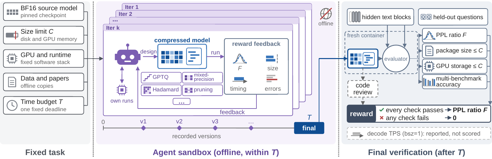
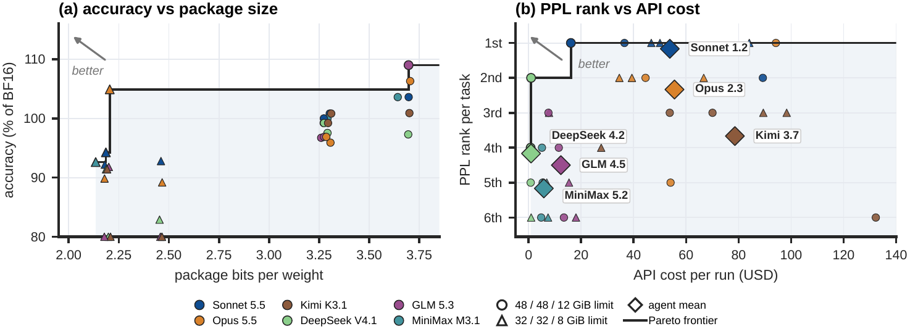

<div align="center">

# compression-bench

### Agent-Driven Language Model Compression

[](https://arxiv.org/abs/2611.06858)
[](LICENSE)
[](#-installation)
[](compression_bench/environments)

**compression-bench turns LLM compression into a task a coding agent carries out end to end.**

</div>

A coding agent receives a pinned BF16 checkpoint, a **size limit *C*** that applies to both the package on
disk and the model's GPU memory, a fixed GPU and inference runtime (vLLM), offline copies of training data
and compression papers, and a **time budget *T***. It must deliver **compressed weights plus executable
inference code**: it chooses the algorithm, runs its own experiments, and uses perplexity feedback from a
public Checker. After the deadline, a hidden Verifier measures the final submission once, in a fresh
no-network container, and the reward is its **fidelity to the BF16 model**.

<p align="center"></p>
<p align="center"><em>A task fixes the source checkpoint, storage allowance <b>C</b>, GPU and runtime, and search budget
<b>T</b>. The agent builds and tests compressed models, revising weights and inference code from reward feedback.
At the deadline a separate evaluator checks the frozen submission's likelihood, generated answers, storage and
execution.</em></p>

## ✨ Key Features

- **Any technique, the agent's own implementation.** Quantization, mixed precision, rotations, pruning,
  low-rank factorization, distillation and kernel work are all allowed; the submission registers its own
  weight format with vLLM and ships its own kernels, and no built-in or third-party quantized format may
  serve a weight.
- **Fidelity to BF16 as the reward.** Perplexity on hidden text continued by the task's own BF16 checkpoint:
  `F = 10 × PPL_bf16 / PPL ≈ 10·exp(−KL)`.
- **Hard gates.** Package size ≤ *C*, GPU-resident storage ≤ *C*, the compression is the submission's own,
  every stage completes, and a hidden correctness gate (math, code, closed-book QA; ≥ 80% of BF16's mean
  accuracy) passes; otherwise the reward is 0. Decode speed is reported, not scored.
- **Full records.** Every version the agent saves is verified after the run, and each run records its
  trajectory, tool calls, timing, resource use and agent cost.

## 📦 Tasks

| Model | Architecture | Size limits |
|---|---|---|
| `nvidia/NVIDIA-Nemotron-3.5-Super-VL-120B-A12B-BF16` | MoE | 48 GiB, 32 GiB |
| `Qwen/Qwen3.5-122B-A10B` | MoE | 48 GiB, 32 GiB |
| `Qwen/Qwen3.8-27B` | dense | 12 GiB, 8 GiB |
| `google/gemma-4-26B-A4B-it` | MoE | 16 GiB, 10 GiB |

Each setting is one task on one H200 NVL with an 8-hour agent budget, named
`<model>_<limit>g_standard_1xH200NVL` (e.g. `qwen3_8_27b_8g_standard_1xH200NVL`). See
[`compression_tasks/README.md`](compression_tasks/README.md).

## 🚀 Installation

Requirements: Linux, NVIDIA GPUs (H200-class for the 120B models), Docker with the NVIDIA container
runtime, Python 3.10+, `pdftotext` (poppler-utils), and a Hugging Face token with access to the gated
checkpoints. A run needs 60 GiB free on the Docker root and 100 GiB on the run root.

```bash
git clone https://github.com/Infini-AI-Lab/Compression-Bench.git
cd Compression-Bench

# Interpreters: the harness (pyyaml), Harbor for the agent container, and the deploy tools.
python3 -m venv .venv-harness && .venv-harness/bin/pip install pyyaml
python3 -m venv .venv-harbor  && .venv-harbor/bin/pip install "harbor==0.21.0"
python3 -m venv .venv-deploy  && .venv-deploy/bin/pip install pyarrow numpy huggingface_hub zstandard transformers
cat > compression_bench/scripts/env.local.sh <<EOF
COMPRESSION_BENCH_PY=$PWD/.venv-harness/bin/python
COMPRESSION_BENCH_HARBOR_PY=$PWD/.venv-harbor/bin/python
EOF
. compression_bench/scripts/env.sh

# Task tokenizers from the Hugging Face Hub, then check every task.
huggingface-cli login            # or: export HF_TOKEN=...
"$COMPRESSION_BENCH_PY" compression_bench/scripts/deploy/fetch_tokenizers.py
"$COMPRESSION_BENCH_PY" compression_tasks/_manage/taskctl.py check

# Images; this also downloads the papers (from their publishers) and the training datasets.
DEPLOY_PY=$PWD/.venv-deploy/bin/python bash compression_bench/scripts/deploy/01-build-images.sh
```

## ⚡ Quick start

One run gives one agent one task on one GPU; when the budget ends, the hidden verdict follows.

**1. Fetch the task's BF16 checkpoint and check the host.**

```bash
.venv-deploy/bin/python compression_bench/scripts/deploy/fetch_model.py compression_tasks/qwen3_8_27b_8g_standard_1xH200NVL
bash compression_bench/scripts/deploy/00-preflight.sh qwen3_8_27b_8g_standard_1xH200NVL
```

**2. Launch an agent.** Claude Code (Opus 5.5, max effort) on Qwen3.8-27B at 8 GiB, on GPU 0, for 8 hours:

```bash
GPU=0 AGENT_CLI=claude setsid nohup bash compression_bench/scripts/compress_evolve/evolve-task.sh \
    qwen3_8_27b_8g_standard_1xH200NVL --hours 8 < /dev/null > evolve.log 2>&1 &
```

**3. Read the result.**

```bash
R=compression_bench/evolve_space/evolve/qwen3_8_27b_8g_standard_1xH200NVL/<run-id>
tail -5 $R/journal.jsonl     # lifecycle events
cat $R/SUMMARY.json          # final verdict and reward
cat $R/METRICS.json          # every saved version's verdict: per-block PPL, gate counts, decode speed
```

Inside the container the agent sees the source model read-only at `/input/model`, writes to `/app/work`
and `/app/submission`, saves versions with `./version`, and checks a candidate with
`python3 /app/check_submission.py /app/submission`. An agent that stops early is resumed into the same
workspace until the deadline.

**Other agents.** Open-weight models run through Claude Code against any Anthropic-compatible endpoint:
copy a provider route from [`compression_bench/scripts/agent/routes/`](compression_bench/scripts/agent/routes),
fill in the key, and pass it as `AGENT_ENV`.

```bash
mkdir -p ~/.config/compression_bench
cp compression_bench/scripts/agent/routes/glm-5p3-fireworks.env.example ~/.config/compression_bench/glm-5p3-fireworks.env
# (fill in the key)
GPU=1 AGENT_ENV=~/.config/compression_bench/glm-5p3-fireworks.env \
AGENT_MODEL=accounts/fireworks/models/glm-5p3 AGENT_EFFORT=max \
    bash compression_bench/scripts/compress_evolve/evolve-task.sh qwen3_8_27b_8g_standard_1xH200NVL --hours 8
```

| Variable | Meaning |
|---|---|
| `AGENT_CLI` | `claude` (Claude Code) or `codex` (Codex CLI) |
| `AGENT_MODEL`, `AGENT_EFFORT` | model id and reasoning effort |
| `AGENT_ENV` | a filled-in provider route file |
| `GPU`, `HOURS` | the card to use; the agent budget (default: the task's) |

## 📊 Results

<p align="center"></p>
<p align="center"><em><b>(a)</b> Mean GSM8K, HumanEval and TriviaQA accuracy relative to BF16 versus package bits per
original parameter. <b>(b)</b> API cost versus within-task PPL rank; diamonds average six tasks per agent.</em></p>

Final verification of six agents, the BF16 reference, GPTQ and released quantizations on the six
Nemotron-3.5 and Qwen settings is in
[`evaluation_progress/leaderboard.csv`](evaluation_progress/leaderboard.csv) (PPL, accuracy, package and
resident size, decode speed, gate); the repeated designs and controlled quantization ablations are in
[`evaluation_progress/ablations.csv`](evaluation_progress/ablations.csv).

## 📚 Documentation

- [`compression_tasks/README.md`](compression_tasks/README.md): the tasks and `taskctl`
- [`compression_bench/README.md`](compression_bench/README.md): the harness
- [`compression_bench/OPERATIONS.md`](compression_bench/OPERATIONS.md): running, scheduling and reading runs
- [`compression_bench/docs/INTERFACES.md`](compression_bench/docs/INTERFACES.md): container and file contracts

## 🗂️ Repository layout

```
compression_tasks/            the tasks: sources (contract.yaml, assets/) and generated Harbor task files
  _manage/                    taskctl: create, change, render and check a task
  _template/                  instruction, Docker and starter templates
compression_bench/
  harness/final_validate/     the evaluator (Checker and Verifier), copied into every task
  harness/lifecycle/          the run driver: workspace, agent container, versions, verdicts, records
  environments/               the agent image (runtime, datasets, papers skill) and the GGUF platform image
  scripts/deploy/             tokenizers, papers, datasets, images, checkpoints, new tasks
  scripts/compress_evolve/    evolve-task.sh, the entry point of one run
  scripts/agent/              Harbor environment, egress proxy, provider route templates
  scripts/baselines/          GPTQ and released-quantization baselines
  scripts/studies/            ablations
  scripts/*.py                scheduler, checkpoint janitor, run analysis
  tests/                      tests of the evaluator, the tasks and the run driver
evaluation_progress/          leaderboard.csv, ablations.csv, record_run.py (per-run rows are written here)
```

## 📝 Citation

If you find CompressionBench useful, please cite our [paper](https://arxiv.org/abs/2611.06858):

```bibtex
@misc{zhong2026compressionbench,
  title={CompressionBench: How can your coding agents compress LLMs?},
  author={Xinrui Zhong and Zhifeng Li and Zhiming Wang and Yongqi Liu and Shanglin Yang and Yang Zhou and Zikun Li and Zhuoming Chen and Beidi Chen},
  year={2026},
  eprint={2611.06858},
  archivePrefix={arXiv},
  primaryClass={cs.AI},
  url={https://arxiv.org/abs/2611.06858}
}
```

## 📄 License

compression-bench is released under the [Apache 2.0 License](LICENSE).
